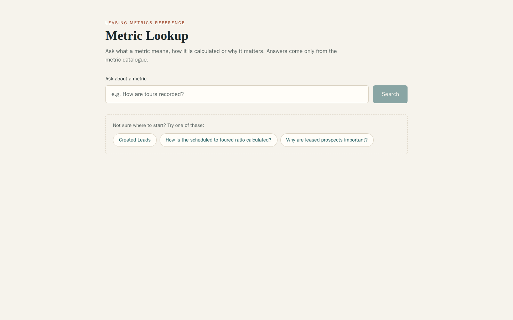
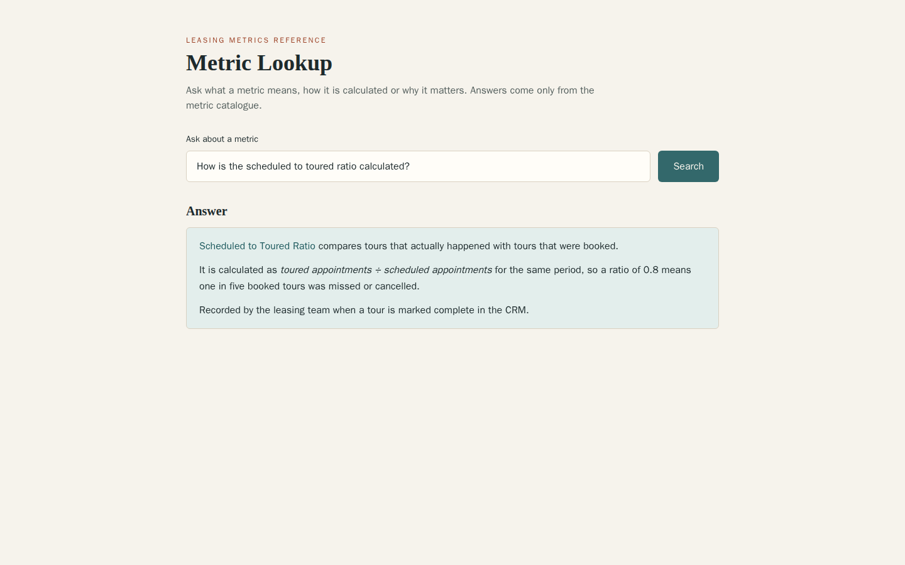
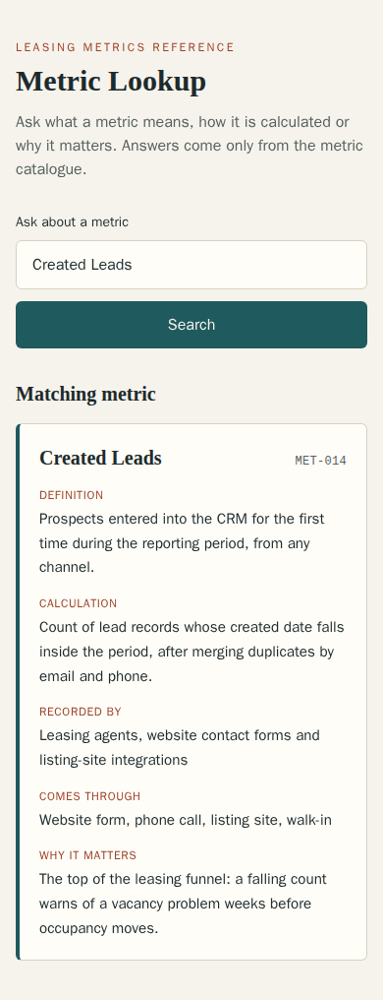
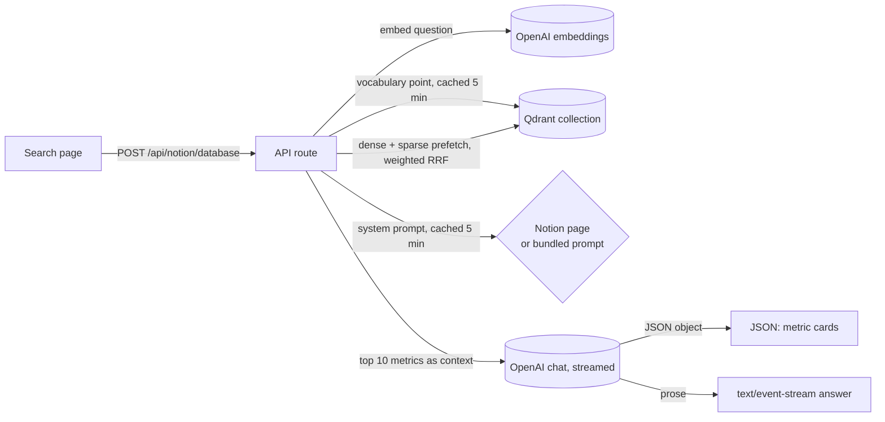

# Metric Lookup

A small Next.js app that answers questions about property-leasing metrics. A leasing team
tracks dozens of funnel numbers (Created Leads, Tours, Scheduled to Toured Ratio, Leased
Prospects and so on), and their definitions live in a metric catalogue. Instead of searching
that catalogue by hand, you type a question and get one of two things:

- **A metric card**, when you just name a metric or ask what it is: its definition, how it is
  calculated, who records it, which channels it comes through and why it matters.
- **A short written answer**, for "how", "why" and comparison questions. The answer is
  streamed as it is generated, and the model is told to use only the catalogue data it was
  given.

The app does not calculate metric values. It explains what each metric means and how it is
measured, so people across the business read the same number the same way.



| Streamed answer | Metric card (mobile) |
| --- | --- |
|  |  |

The screenshots use made-up demo metrics.

## How a question is answered



1. The question is embedded with `text-embedding-3-small` and also turned into a sparse
   keyword vector, using the token-to-index vocabulary stored in the collection.
2. Qdrant runs both searches and fuses them with reciprocal rank fusion, weighted 0.8 dense to
   0.2 keyword. The ten best metrics become the model's context.
3. The chat model either returns a small JSON object naming the metric(s) asked about, or
   writes prose. The route reads the stream just far enough to tell which. JSON becomes metric
   cards; prose is passed through to the browser as server-sent events.

## Setup

You need Node 22 (see `.nvmrc`) or Docker, an OpenAI API key and a Qdrant collection laid out
as described in [Data the app expects](#data-the-app-expects).

```bash
cp .env.example .env    # then fill in OPENAI_API_KEY and QDRANT_URL
npm ci
npm run dev             # http://localhost:3000
```

| Variable | Required | Purpose |
| --- | --- | --- |
| `OPENAI_API_KEY` | yes | Embeddings and chat completions |
| `QDRANT_URL` | yes | Qdrant endpoint, for example `http://localhost:6333` |
| `QDRANT_API_KEY` | no | Needed for Qdrant Cloud, not for a local instance |
| `QDRANT_COLLECTION` | no | Collection name, default `metric_definitions` |
| `OPENAI_EMBEDDING_MODEL`, `OPENAI_CHAT_MODEL` | no | Defaults `text-embedding-3-small` and `gpt-4o` |
| `NOTION_API_KEY`, `NOTION_PROMPT_PAGE_ID` | no | Load the system prompt from a Notion page (see below) |

If a required variable is missing, the page still loads and searches return
`503 Search is not configured` with the names of the missing variables.

### Docker

```bash
docker build -t metric-lookup .
docker run --rm -p 3000:3000 --env-file .env metric-lookup
```

The image runs Next's standalone server as the unprivileged `node` user. Inside the container
`localhost` is the container itself, so point `QDRANT_URL` at `http://host.docker.internal:6333`
to reach a Qdrant running on your machine.

## Data the app expects

This repository holds the search app only. Loading metrics into Qdrant happens elsewhere, but
the collection has to look like this:

- a named dense vector `dense` sized for the embedding model (1536 for `text-embedding-3-small`);
- a named sparse vector `sparse`;
- a reserved point with ID `00000000-0000-0000-0000-000000000000` whose payload is
  `{ "vocabulary": { "<token>": <sparse index>, ... } }`. The sparse vectors must be built with
  the same tokenizer as `src/lib/sparse.js`, or keyword matches will not line up;
- one point per metric, with payload fields such as `UID`, `Business Name`, `m_Definition` (or
  `Definition`), `m_Calculation` (or `Calculations`), `m_Recorded By`, `m_They Come Through`,
  `Importance`, `Value Type`, `Performance Indicator`, `Data Sources`, `Aggregation Type` and
  `Aliases`. Empty fields are skipped.

### The system prompt

The prompt that tells the model when to answer with JSON and when to write prose is in
`src/lib/systemPrompt.js`. If `NOTION_API_KEY` and `NOTION_PROMPT_PAGE_ID` are both set, the
first JavaScript code block on that Notion page is used instead, so the prompt can be tuned
without a redeploy. The page is re-read at most every five minutes.

## API

`POST /api/notion/database` takes `{"query": "...", "prefetch_limit": 15}`. The query must be a
non-empty string of at most 500 characters; `prefetch_limit` is optional and clamped to 1–50.
The two examples below were captured from the app running against a local Qdrant seeded with
demo metrics and a stand-in for the OpenAI API.

A metric name gets JSON with the matching card(s):

```http
POST /api/notion/database
Content-Type: application/json

{"query": "Created Leads"}
```

```json
{
  "success": true,
  "query": "Created Leads",
  "resultCount": 2,
  "searchType": "direct_response",
  "directResponse": {"directResponse": true, "metrics": [{"id": "MET-014", "title": "Created Leads"}]},
  "retrievedMetrics": [
    {
      "id": "MET-014",
      "title": "Created Leads",
      "description": "Prospects entered into the CRM for the first time during the reporting period.",
      "calculations": "Count of lead records whose created date falls inside the period.",
      "recordedBy": "Leasing agents and web forms",
      "importance": "Top-of-funnel demand signal.",
      "sources": ["Website form, phone call, listing site"],
      "score": 0.6111111
    }
  ]
}
```

Other questions get a `text/event-stream` (content events shortened here):

```text
data: {"type":"metadata","query":"How is the scheduled to toured ratio calculated?","resultCount":2,"searchType":"hybrid_native_fusion","fusionType":"rrf"}

data: {"type":"content","content":"**Scheduled to Toured Ra"}

data: {"type":"content","content":"tio** compares completed"}

data: {"type":"done","retrievedMetrics":[{"id":"MET-031","title":"Scheduled to Toured Ratio","score":0.6111111},{"id":"MET-014","title":"Created Leads","score":0.2857143}]}
```

If the model connection drops mid-answer, the stream ends with
`{"type":"error","message":"The answer was interrupted. Please try again."}`.

Errors are JSON: `400` for invalid JSON or a bad query, `503` with a `missing` list when
configuration is incomplete, `404` when the collection does not exist, and a generic `500`
otherwise (details go to the server log, not the client).

## Tests

```bash
npm test        # Vitest: route, helpers and components; no network or keys needed
npm run lint
npm run build
```

The route tests replace the Qdrant, OpenAI and Notion clients with fakes. One extra test
checks the real hybrid query against a disposable Qdrant and is skipped unless you point it
at one:

```bash
docker run --rm -p 6333:6333 qdrant/qdrant
QDRANT_TEST_URL=http://localhost:6333 npm test
```

## Design notes

- **One model call per question.** The route streams the completion once and peeks at the
  first visible character: `{` or a code fence means the JSON form, which is read to the end
  and parsed; anything else is prose and is streamed straight through.
- **Cards follow the model's choice.** For a JSON answer the page shows the metrics the model
  named, in its order, using the catalogue data from Qdrant rather than the model's copy. If
  it names nothing that was retrieved, the best search hit is shown.
- **Scores are ranks, not similarity.** Fusion scores come from rank positions, so the page
  does not filter on a score threshold.
- **Keys are read on first request**, not at import time, so `npm run build` works without any
  secrets.
- The route path `/api/notion/database` is historical (the prompt used to be required from
  Notion) and is kept so existing callers keep working.

## Licence

MIT, see [LICENSE](LICENSE).
